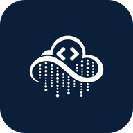
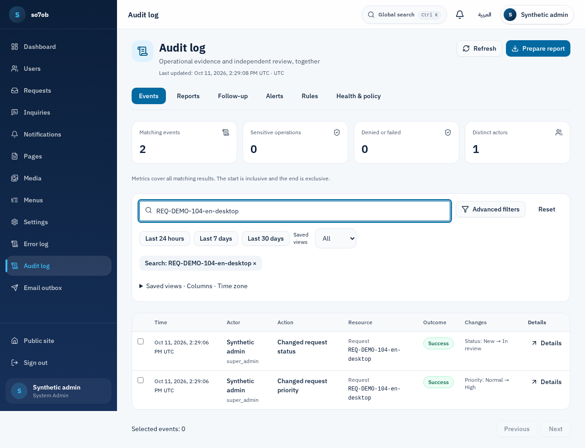
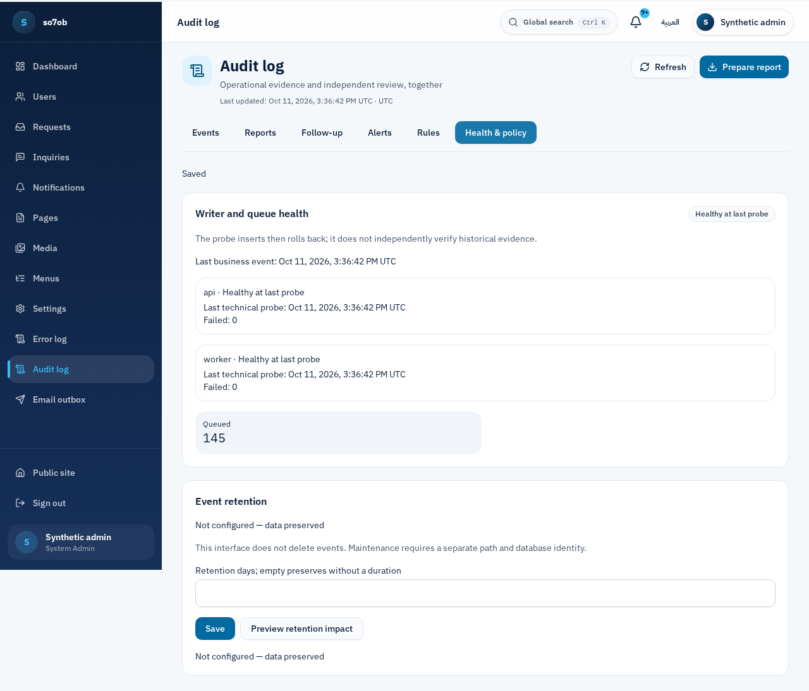
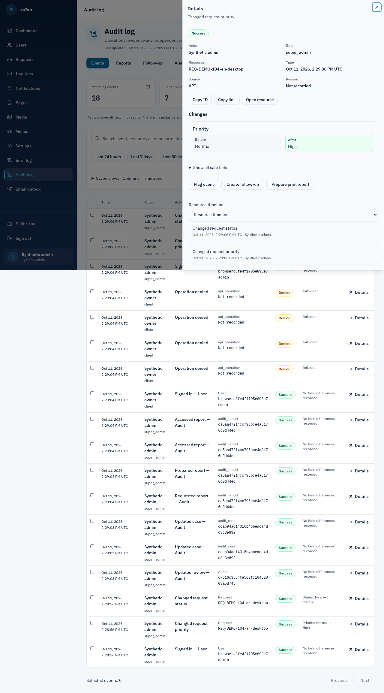
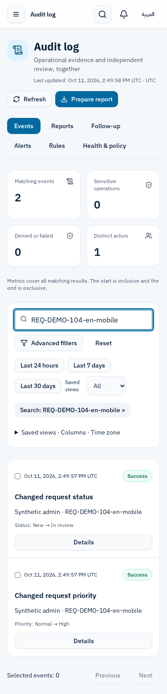
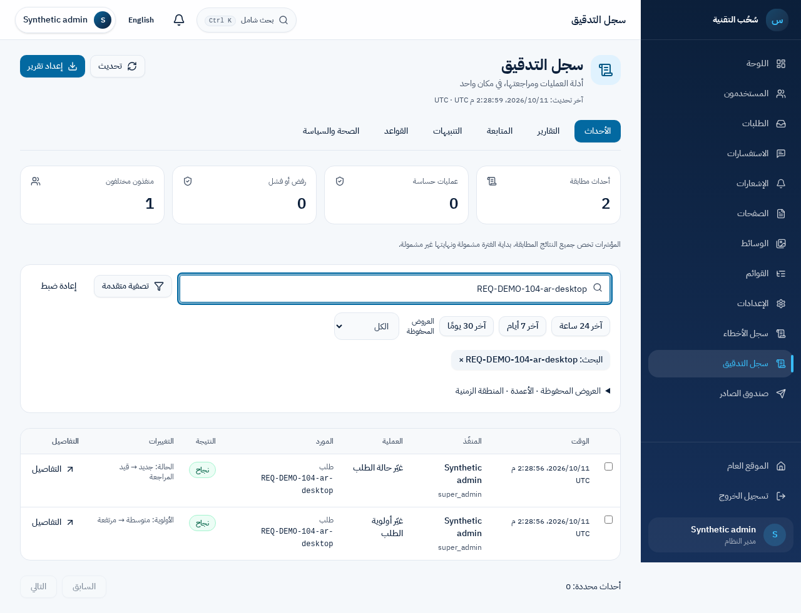
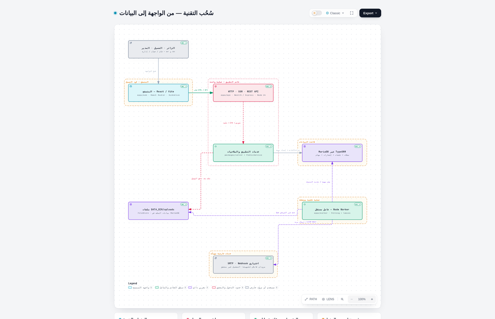

<div align="center">
  
  <h1>So7ob · سُحُب</h1>
  <p>A bilingual platform for content, service requests, customer support and operational review.</p>
  <p><a href="README.md">العربية</a> · <a href="docs/releases/v1.2.0.md">v1.2.0 release notes</a> · <a href="docs/migration/local-development.ar.md">Local setup guide</a> · <a href="CONTRIBUTING.md">Contributing</a></p>
</div>

[](https://github.com/so7ob/web/actions/workflows/ci.yml)
[](https://github.com/so7ob/web/releases/latest)

So7ob brings a public website, customer account and administration workspace into one Arabic/English application, with RTL/LTR layouts, server authorization and an independent background worker. The product runs on **Node.js, React, NestJS and MariaDB**.

## Explore the platform

| Workspace | Capabilities |
|---|---|
| Public website | Arabic/English pages, service requests and inquiries |
| Customer account | Requests, conversations, files, notifications, profile and sessions |
| Administration and content | Users and roles, request assignment and priority, page editing, publishing and scheduling |
| Audit investigation | Search and filters, historical actors, explicit resources, before/after changes and related events |
| Reports and review | Worker-prepared CSV/JSON/printable reports, independent cases and notes, permission checks at download |
| Diagnostics and operations | Redacted correlated errors, worker and queue monitoring, deterministic alerts and audit health |

## Product tour



Search a resource reference, inspect its changes and follow the related events. Metrics cover the matching result set; investigation notes remain separate from the original evidence.

### Writer health and policy



<details>
<summary>Before/after event details</summary>



</details>

<details>
<summary>Mobile and Arabic views</summary>

<p align="center"></p>



</details>

**Image provenance:** actual synthetic acceptance runs at 375/1280 CSS pixels. Investigation captures are from `abf3304`; health captures are from `d978938`. See [audit verification](docs/migration/audit-70/verification.md) and [collation regression evidence](docs/migration/audit-72/README.md) for source versions and limits. These are neither customer accounts nor design mockups.

## New in v1.2.0

- An audit investigation workspace with historical identities, redacted changes, personal views, independent reviews, background reports, alert rules and health checks.
- Correlated diagnostics using `requestId` and `errorId`, with clear failure feedback and retained inputs/drafts.
- Reliable request status/priority changes, replies and exports, plus stale-write protection for menus and settings.
- Independent worker monitoring, consistent response deadlines, bounded conversation queries and administrative accessibility improvements.

[Full scope, upgrade and rollback notes](docs/releases/v1.2.0.md) · [Published releases](https://github.com/so7ob/web/releases)

## Run locally

Pinned prerequisites: **Node 24.21.0 · npm 10.8.2 · MariaDB 10.11.18**. Use a separate development database; never target production data.

```sh
git clone https://github.com/so7ob/web.git
cd web
npm ci
cp .env.example .env
```

Configure MariaDB and `DATABASE_NAME` in the untracked `.env`. Generate independent random `AUTH_SECRET` and `OUTBOX_KEY` values. Set `DATA_DIR` to a private, writable absolute path outside the application directory, and match `SITE_URL`/`WEB_ORIGIN` to the browser origin. Replace every `replace-*` placeholder before starting.

```sh
npm run db:migrate
```

This creates the schema only. **For a new, empty development database**, substitute the exact `.env` database name for `YOUR_LOCAL_DATABASE`:

```sh
npm run site:init -- --database=YOUR_LOCAL_DATABASE --confirm-empty
npm run admin:create -- --database=YOUR_LOCAL_DATABASE --email=admin@example.com --name="Administrator"
npm run build
npm run dev
```

`site:init` installs the seven original bilingual public pages, menus and settings, and refuses an existing site. `admin:create` prints a random password once and refuses an existing administrator; there are no default credentials. Bootstrap tools require `NODE_ENV=development` and loopback MariaDB. Skip initialization for imported sites and follow the [data-transfer guide](docs/migration/data-transfer.md).

Configure `SMTP_HOST`, `SMTP_FROM` and an SMTP service before starting the worker; `EMAIL_DEV_MODE` does not replace worker transport configuration. Start the worker in a **second terminal**, with the same database, private `DATA_DIR` and secrets:

```sh
node --env-file=.env apps/worker/dist/main.js
```

The worker handles mail, scheduled work and reports; the web server alone does not complete those jobs. Open `http://127.0.0.1:3108/en` or `/ar`; sign in at `/en/auth/login`, then visit `/en/admin`. The [local setup guide](docs/migration/local-development.ar.md) explains bootstrap safeguards and troubleshooting.

## Architecture



| Path | Responsibility |
|---|---|
| `apps/web` | React, Vite and React Router; browser UI and SSR; its `public/` is the static asset source |
| `apps/api` | NestJS/Express; REST, sessions, authorization and SSR hosting |
| `apps/worker` | Independent Node worker polling MariaDB jobs with leases and locks |
| `packages/contracts` | Shared data contracts, permissions and validation |
| `packages/server` | Business rules, audit and TypeORM/mysql2 persistence |

Private files are served after authorization. Mail, webhook, cleanup and report jobs use MariaDB; the product does not require Redis or Kafka. The architecture diagram is pinned to its creation source: see the [source-backed explanation](docs/migration/architecture-explained-2026-10-09.ar.md) and [interactive diagram index](.archify/README.md). Download the HTML files to explore them; GitHub displays their source.

## Privacy and upgrades

Audit evidence is separate from diagnostics. Business changes and their success events share a transaction; historical identity is independent of the current account. Export, review, rules and policy permissions are separate and are not automatically granted to other roles. The existing `super_admin` bypass remains.

For an existing site, follow the [audit runbook](docs/migration/audit-70/runbook.md): pause writers during transition, apply migrations with a separate identity, and review runtime grants that allow only SELECT/INSERT on audit evidence. Event retention is **unconfigured by default**. Temporary report files expire after 24 hours without deleting original events. File checksums alone do not prove evidence origin; no DBA-resistant or compliance-certification claim is made.

## Verify

```sh
npm run lint
npm run typecheck
npm test
npm run build
npm run test:independence
npm run test:e2e
npm run test:infra
git diff --check
```

[Clean-checkout verification](docs/testing.md) documents services, test databases and CI/maintenance commands. Use isolated MariaDB and synthetic fixtures. Set `TEST_DATABASE_NAME` for integration tests; browser tests require `DATABASE_NAME` matching `so7ob_*_test` and Playwright Chromium. CI also runs worker, file, webhook, authentication, CMS boundary and restore checks. The [latest fix evidence](docs/migration/audit-72/README.md) records **895 tests and 240 browser journeys** for its pinned source; consult [GitHub Actions](https://github.com/so7ob/web/actions) for subsequent commits.

## Documentation map

| Topic | Guide |
|---|---|
| Investigation, reports and review | [Audit workspace and acceptance matrix](docs/migration/audit-70/README.md) |
| Permissions, operations and retention | [Audit runbook](docs/migration/audit-70/runbook.md) |
| Errors and correlation | [Safe diagnostics](docs/migration/error-diagnostics-61.md) |
| Worker and queues | [Worker operations](docs/migration/worker-and-operations.md) · [Worker health](docs/migration/worker-health-50.md) |
| Recovery | [Independent recovery requirements](docs/migration/independent-recovery-56.md) |
| Source migration | [Final acceptance](docs/migration/final-code-parity.md) · [Source provenance](docs/migration/source-provenance.md) |
| Contributions | [CONTRIBUTING](CONTRIBUTING.md) · [Repository instructions](AGENTS.md) |

## Provenance and contributions

This is an independent implementation preserving the identity and functionality of [so7ob/Website](https://github.com/so7ob/Website). Original import: `5321b7fd11db421c83290b262f276811e5f04e5f`; pinned comparison: `dddf8cd00a19cf7d562f503549f4c000109057d1`. [Rakim](https://github.com/so7ob/Rakim) at `cae0950bac45d97971bd3766c8c34f9869a856af` is a read-only architectural reference.

Code and functional migration acceptance is complete within the [documented scope](docs/migration/final-code-parity.md). Production deployment, data migration and off-host recovery require separate verification. The product does not run on Next.js, Prisma or Bun; `npm run test:independence` checks the product and its tools without a source archive or historical checkout.

All implementation, documentation, issues and PRs belong to `so7ob/web`: **Issue → branch → PR → checks → review**. [Local skills](.agents/skills) and diagram tools support development and are not runtime dependencies. Existing source copyright and third-party notices remain applicable. The So7ob name and logo belong to سُحُب التقنية; IBM Plex fonts retain their OFL notices.
