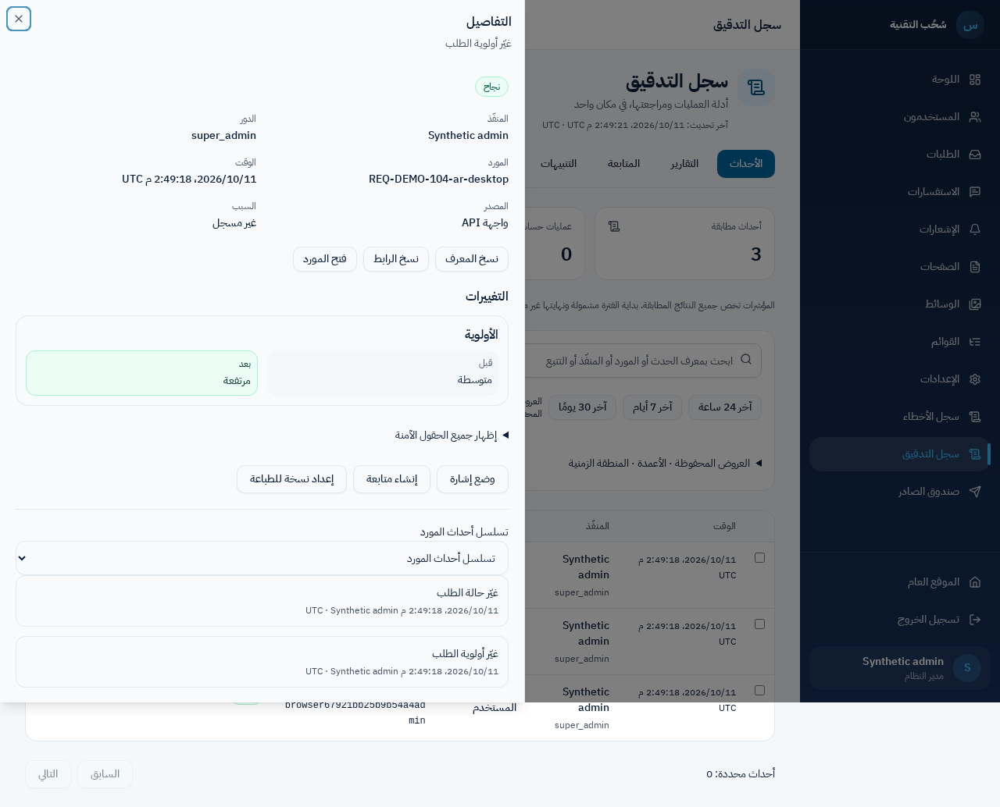
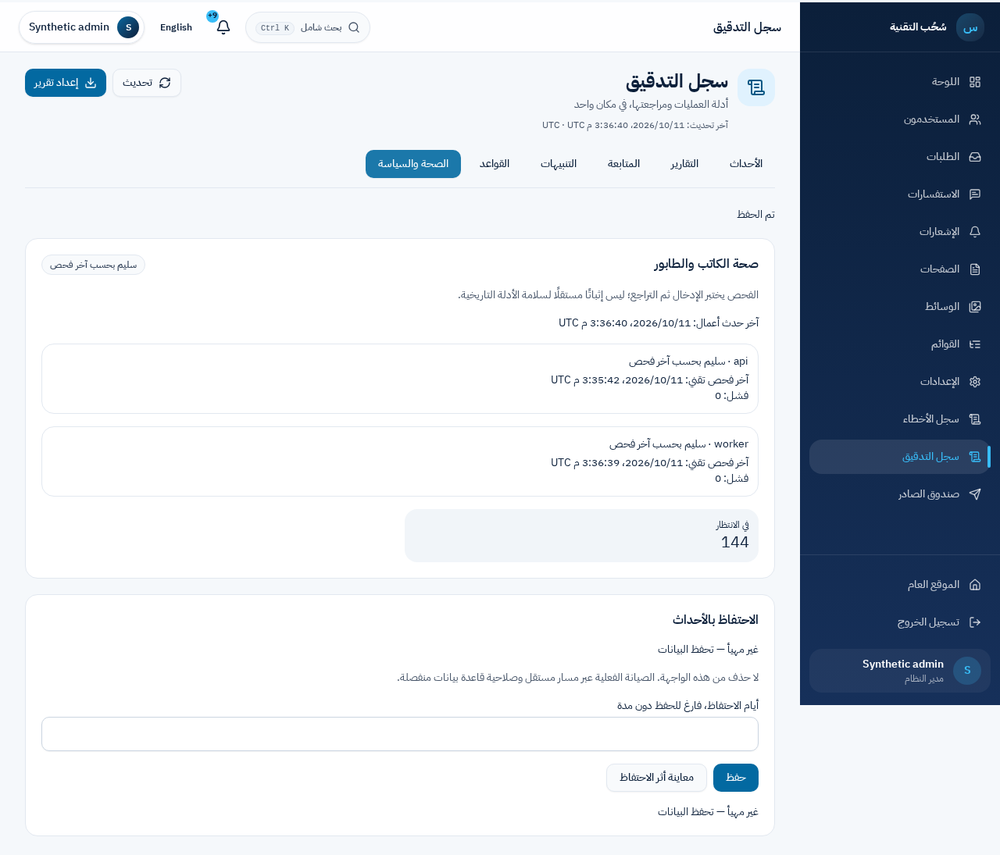
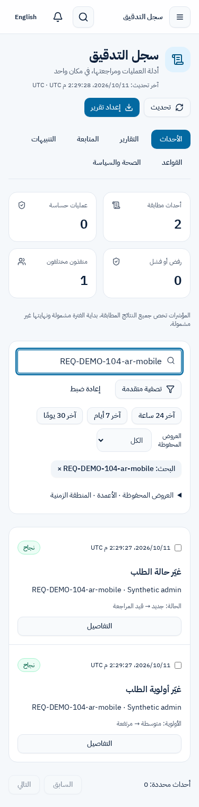

<div align="center">
  
  <h1>سُحُب · So7ob</h1>
  <p>منصة عربية وإنجليزية لإدارة المحتوى والطلبات وخدمة العملاء والتحقيق في العمليات.</p>
  <p><a href="README.en.md">English</a> · <a href="docs/releases/v1.2.0.md">ملاحظات v1.2.0</a> · <a href="docs/migration/local-development.ar.md">التشغيل المحلي</a> · <a href="CONTRIBUTING.md">المساهمة</a></p>
</div>

[](https://github.com/so7ob/web/actions/workflows/ci.yml)
[](https://github.com/so7ob/web/releases/latest)

تجمع سُحُب الموقع العام وحساب العميل ولوحة الإدارة في تطبيق واحد ثنائي اللغة، بواجهة RTL/LTR وصلاحيات خادمية وعامل خلفي مستقل. يعتمد تشغيل المنتج على **Node.js وReact وNestJS وMariaDB**.

## ما الذي توفره المنصة؟

| المساحة | ما يمكنك إنجازه |
|---|---|
| الموقع العام | نشر الصفحات العربية والإنجليزية، وتلقي طلبات الخدمات والاستفسارات |
| حساب العميل | متابعة الطلبات والمحادثات والملفات والإشعارات وإدارة الحساب والجلسات |
| الإدارة والمحتوى | إدارة المستخدمين والأدوار، تعيين الطلبات وأولوياتها، تحرير الصفحات ونشرها وجدولتها |
| سجل التدقيق | البحث والتصفية، معرفة المنفذ والمورد، مقارنة قبل/بعد، تتبع الأحداث وإنشاء مراجعة مستقلة |
| التقارير | إعداد CSV وJSON وتقارير قابلة للطباعة عبر العامل، وتنزيلها بعد إعادة التحقق من الصلاحيات |
| التشخيص والتشغيل | أخطاء منقحة مرتبطة بمعرفات تتبع، مراقبة العامل والطوابير، قواعد تنبيه حتمية وصحة التدقيق |

## جولة داخل المنتج

### سجل الأحداث


تبحث عن مرجع المورد، ثم تفتح تفاصيل الحدث لمراجعة القيم قبل التغيير وبعده. المؤشرات تخص النتائج المطابقة كاملة، وتظل المراجعة منفصلة عن الدليل الأصلي.

| مقارنة قبل/بعد | صحة الكاتب والسياسة |
|---|---|
|  |  |

<details>
<summary>عرض الهاتف والواجهة الإنجليزية</summary>

<p align="center"></p>


</details>

**مصدر الصور:** لقطات من اختبارات تشغيل فعلية ببيانات اصطناعية فقط، بعرضي 375 و1280. صور التحقيق من `abf3304`، وصور الصحة من `d978938`. راجع [أدلة التدقيق](docs/migration/audit-70/verification.md) و[إصلاح توافق المقارنات](docs/migration/audit-72/README.md) للنسخ والفحوص والحدود؛ الصور ليست حسابات عملاء أو نماذج تصميم.

## الجديد في v1.2.0

- مساحة تحقيق متكاملة: أحداث بهوية تاريخية، فروق منقحة، عروض شخصية، مراجعات وقضايا مستقلة، تقارير وقواعد تنبيه وصحة تشغيلية.
- تشخيص خادمي بمعرفي `requestId` و`errorId`، مع رسائل فشل واضحة وحفظ المدخلات والمسودات عند التعثر.
- إصلاح تغييرات حالة الطلب وأولويته، وتحسين موثوقية الردود والتصدير والتعارضات في القوائم والإعدادات.
- مراقبة العامل المستقل، وتوحيد سياسة مهلة الرد، وتحسين استعلامات المحادثات وإتاحة لوحة الإدارة.

[النطاق الكامل والترقية والتراجع](docs/releases/v1.2.0.md) · [الإصدارات المنشورة](https://github.com/so7ob/web/releases)

## التشغيل المحلي

المتطلبات المثبتة: **Node 24.21.0 · npm 10.8.2 · MariaDB 10.11.18**. استخدم قاعدة تطوير مستقلة؛ لا توجّه الأوامر إلى بيانات إنتاج.

```sh
git clone https://github.com/so7ob/web.git
cd web
npm ci
cp .env.example .env
```

قبل المتابعة، اضبط اتصال MariaDB و`DATABASE_NAME` في `.env`، وأنشئ قيمتين عشوائيتين مستقلتين لـ`AUTH_SECRET` و`OUTBOX_KEY`. اضبط `DATA_DIR` على مسار مطلق خاص قابل للكتابة خارج مجلد التطبيق، واجعل `SITE_URL` و`WEB_ORIGIN` يطابقان عنوان المتصفح. قيم `replace-*` أمثلة لا تصلح للتشغيل.

```sh
npm run db:migrate
```

ينشئ هذا الأمر المخطط فقط. **لقاعدة تطوير جديدة وفارغة وحدها**، استبدل `YOUR_LOCAL_DATABASE` بالاسم نفسه الموجود في `.env`:

```sh
npm run site:init -- --database=YOUR_LOCAL_DATABASE --confirm-empty
npm run admin:create -- --database=YOUR_LOCAL_DATABASE --email=admin@example.com --name="مدير النظام"
npm run build
npm run dev
```

ينشئ `site:init` الصفحات العامة السبع باللغتين والقوائم والإعدادات، ويرفض الكتابة فوق موقع قائم. يطبع `admin:create` كلمة مرور عشوائية مرة واحدة ويرفض وجود مدير سابق؛ لا توجد بيانات دخول افتراضية. تتطلب أدوات التهيئة `NODE_ENV=development` واتصال قاعدة محليًا. للموقع المستورد، تخطَّ التهيئة واتبع [دليل نقل البيانات](docs/migration/data-transfer.md).

شغّل العامل في **طرفية ثانية**، بنفس قاعدة البيانات و`DATA_DIR` والأسرار:

```sh
node --env-file=.env apps/worker/dist/main.js
```

العامل ينفّذ البريد والمهام المجدولة والتقارير؛ تشغيل خادم الويب وحده لا يكمل هذه المهام. افتح `http://127.0.0.1:3108/ar` أو `/en`؛ الدخول عبر `/ar/auth/login` والإدارة عبر `/ar/admin`. [دليل التطوير وإنشاء المدير](docs/migration/local-development.ar.md) يشرح الإعداد والقيود بالتفصيل.

## البنية البرمجية


| المسار | المسؤولية |
|---|---|
| `apps/web` | React + Vite + React Router؛ واجهة المتصفح وSSR |
| `apps/api` | NestJS + Express؛ REST والجلسات والصلاحيات واستضافة SSR |
| `apps/worker` | عامل Node مستقل يستطلع مهام MariaDB بإيجارات وأقفال |
| `packages/contracts` | عقود البيانات والأذون والتحقق المشتركة |
| `packages/server` | منطق الأعمال والتدقيق والتخزين عبر TypeORM/mysql2 |
| `reference/` | أرشيف المصدر التاريخي، معزول عن تشغيل المنتج |

الخادم يتحقق من الوصول قبل خدمة الملفات الخاصة. تُحفظ مهام البريد وWebhook والتنظيف والتقارير في MariaDB؛ لا يحتاج المنتج إلى Redis أو Kafka. مخطط البنية مثبت بتاريخ إنشائه؛ [شرح البنية](docs/migration/architecture-explained-2026-10-09.ar.md) و[مخططات التسلسل التفاعلية](.archify/README.md) يوضحان مصدره وحدوده. GitHub يعرض مصدر HTML؛ نزّل الملف لفتحه تفاعليًا.

## الخصوصية والترقية

التدقيق منفصل عن التشخيص. أحداث النجاح تُحفظ مع تغيير الأعمال في المعاملة نفسها، وتبقى الهوية التاريخية مستقلة عن الحساب الحالي. التصدير والمراجعة والقواعد والسياسة لها أذون مستقلة؛ لا تُمنح تلقائيًا للأدوار الأخرى، ويبقى تجاوز `super_admin` القائم.

قبل ترقية موقع موجود، اتبع [دليل تشغيل التدقيق](docs/migration/audit-70/runbook.md): أوقف الكتّاب أثناء الانتقال، وشغّل migrations بحساب منفصل، وراجع حساب التشغيل الذي يقتصر على SELECT/INSERT لسجل الأدلة. الاحتفاظ **غير مهيأ افتراضيًا**؛ ملفات التقارير المؤقتة تنتهي بعد 24 ساعة دون حذف الأحداث. لا يثبت checksum وحده أصل الدليل، ولا توجد دعوى حصانة من مسؤول قاعدة البيانات أو شهادة امتثال.

## التحقق

```sh
npm run lint
npm run typecheck
npm test
npm run build
npm run test:e2e
npm run test:infra
git diff --check
```

تحتاج الاختبارات إلى MariaDB معزولة وبيانات اصطناعية. اضبط `TEST_DATABASE_NAME` للتكامل، واستخدم `DATABASE_NAME` مطابقًا للنمط `so7ob_*_test` للمتصفح مع Chromium الخاص بـPlaywright. تشغّل CI أيضًا اختبارات العامل والملفات وWebhook والمصادقة وحدود CMS والاستعادة. [آخر أدلة الإصلاح](docs/migration/audit-72/README.md) تسجل **895 اختبارًا و240 مسار متصفح** على النسخة المحددة فيها؛ [GitHub Actions](https://github.com/so7ob/web/actions) هو مرجع نتائج كل التزام لاحق.

## دليل الوثائق

| الموضوع | المرجع |
|---|---|
| البحث والتقارير والمراجعات | [دليل سجل التدقيق ومصفوفة القبول](docs/migration/audit-70/README.md) |
| التشغيل والأذون والاحتفاظ | [دليل التدقيق التشغيلي](docs/migration/audit-70/runbook.md) |
| معالجة الأخطاء والتتبع | [التشخيص الآمن](docs/migration/error-diagnostics-61.md) |
| العامل والطوابير | [التشغيل الخلفي](docs/migration/worker-and-operations.md) · [صحة العامل](docs/migration/worker-health-50.md) |
| التعافي | [متطلبات الاستعادة المستقلة](docs/migration/independent-recovery-56.md) |
| النقل من المصدر | [القبول النهائي](docs/migration/final-code-parity.md) · [عزل المرجع](docs/migration/reference-isolation.md) |
| المساهمة | [CONTRIBUTING](CONTRIBUTING.md) · [تعليمات المستودع](AGENTS.md) |

## المصدر والمساهمة

هذا تنفيذ مستقل يحافظ على هوية ووظائف [so7ob/Website](https://github.com/so7ob/Website). خط الاستيراد الأصلي `5321b7fd11db421c83290b262f276811e5f04e5f`، والمقارنة المثبتة `dddf8cd00a19cf7d562f503549f4c000109057d1`. استُخدم [Rakim](https://github.com/so7ob/Rakim) عند `cae0950bac45d97971bd3766c8c34f9869a856af` مرجعًا معماريًا للقراءة فقط.

اكتمل قبول نقل الكود والوظائف ضمن [النطاق الموثق](docs/migration/final-code-parity.md)؛ نشر الإنتاج ونقل بياناته والاستعادة خارج المضيف لها إجراءات تحقق مستقلة. تشغيل المنتج لا يعتمد على Next.js أو Prisma أو Bun؛ `npm run test:independence` يتحقق من عزل الأرشيف.

كل الكود والوثائق وIssues وPRs تُدار في `so7ob/web`: **Issue → فرع → PR → فحوص → مراجعة**. [المهارات المحلية](.agents/skills) وأدوات المخططات أدوات تطوير وليست اعتمادات تشغيل. تبقى حقوق المصدر وإشعارات الأطراف الثالثة سارية؛ اسم وشعار سُحُب للتقنية، وخطوط IBM Plex تحت إشعارات OFL الخاصة بها.
