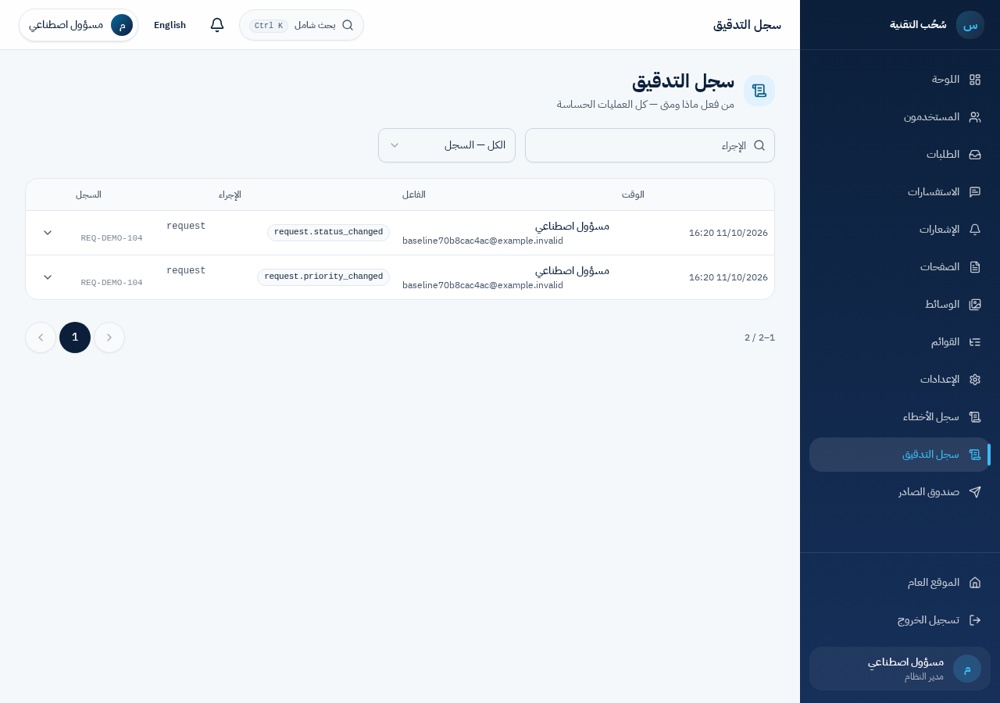

# سجل التدقيق — مساحة التحقيق والمراجعة

[Issue #70](https://github.com/so7ob/web/issues/70) · الفرع `feat/70-audit-investigation` · قاعدة المراجعة `develop`.

تحولت صفحة التدقيق من جدول وJSON إلى مساحة ثنائية اللغة للبحث والفروق والتتبع، بعروض شخصية وتقارير ينفذها العامل ومتابعات مستقلة وقواعد تنبيه وصحة تشغيلية. حدث النجاح يُحفظ مع تغيير الأعمال، والهوية التاريخية مستقلة عن الحساب الحالي. التصدير والمراجعة وإدارة السياسة لها أذون مستقلة.

- [مصفوفة المتطلبات والتغطية وحالات القبول](requirements.md)
- [نتائج الاختبارات والقياس ومصدر الصور والمعاينة](verification.md)
- [كتالوج الأحداث والحقول المسموح بها ومواضع التسجيل](catalog.md)
- [العقود والمعاملات واللقطات والخصوصية وحدود سلامة الدليل](architecture.md)
- [دليل الاستخدام والتشغيل والصلاحيات والصيانة والتعافي](runbook.md)

المعاينة المحلية: [العربية](https://127.0.0.1:3213/ar/admin/audit) و[English](https://127.0.0.1:3213/en/admin/audit). بيانات الدخول الاصطناعية في الملف المحلي الخاص `.migration/audit-implementation/live/login.json`؛ لا توجد كلمات مرور في هذه الوثائق أو Git.

| قبل — العربية | بعد — العربية |
|---|---|
|  |  |

المراجعات والتنبيهات لا تغيّر الحدث الأصلي. الاحتفاظ غير مهيأ افتراضيًا ولا يحذف البيانات. التوقيع الخارجي والتخزين المستقل والإرسال الخارجي غير مفعلة؛ حدودها ومتطلبات تفعيلها موثقة. لا دمج أو نشر أو ترحيل إنتاج تلقائي.
